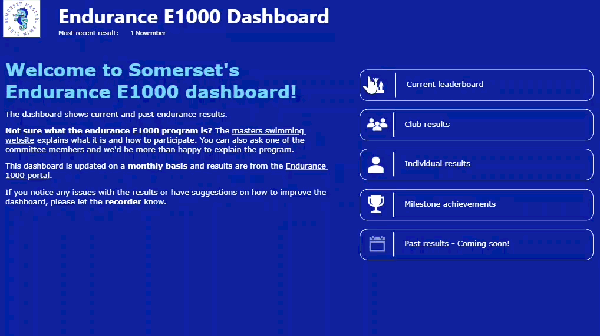
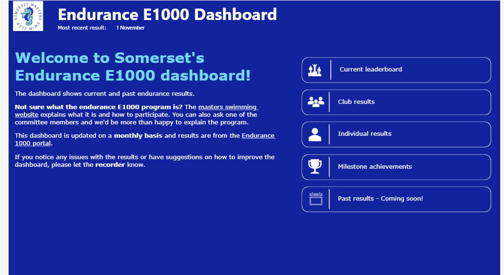
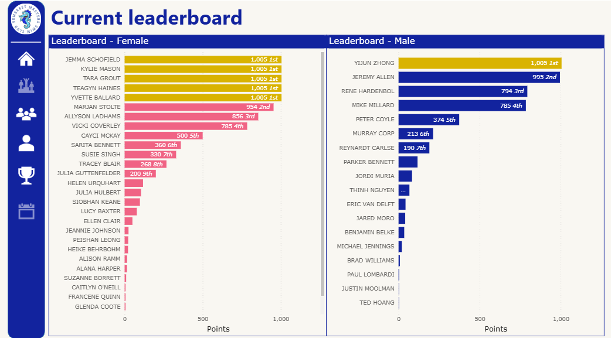
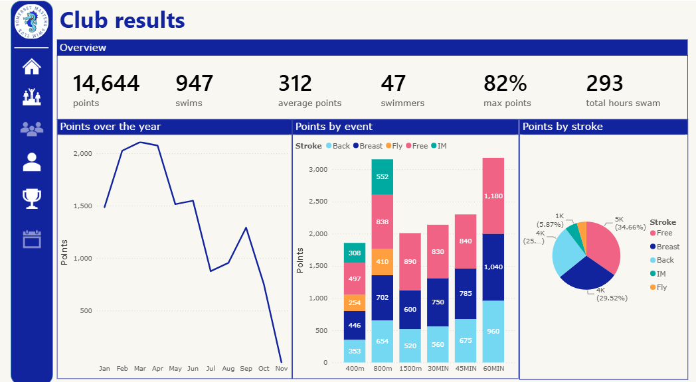
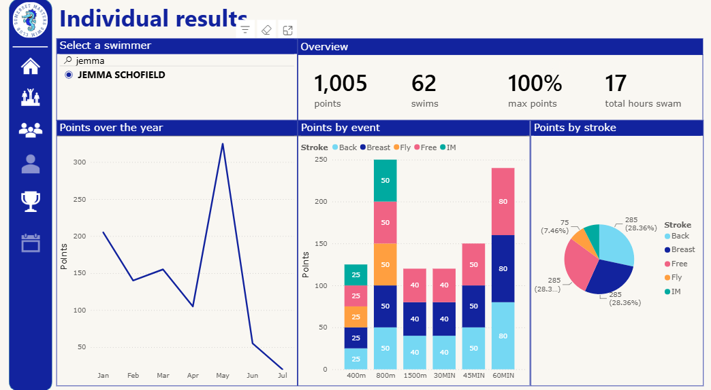
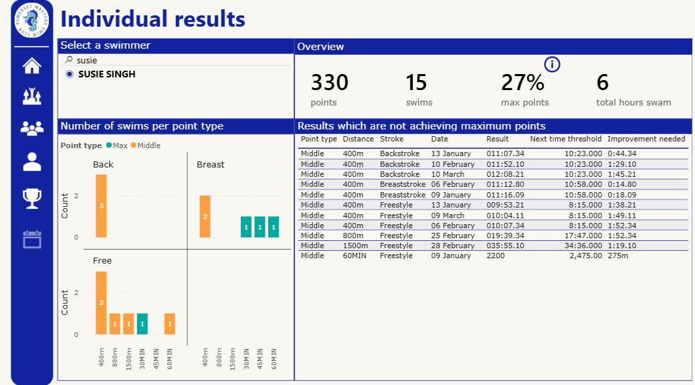
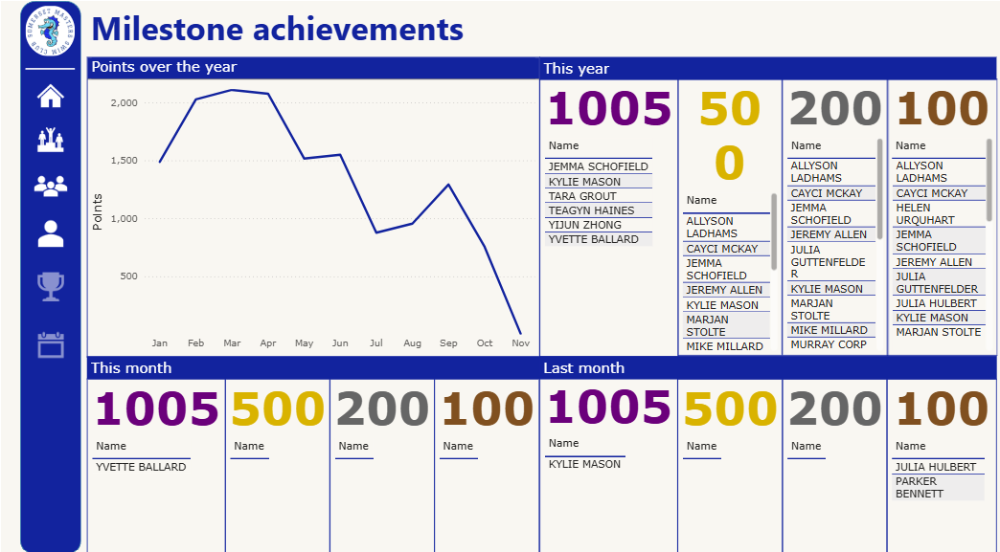

# Power BI Dashboard - Endurance results

This dashboard was designed for the Somerset Masters Swimming club for the endurance (E1000) competition. This competition runs annually and requires swimmers to complete a variety of 400m, 800m, 1500m 30MIN, 45MIN and 60MIN swims in different strokes across the year. 

Link: https://www.somersetmasters.org.au/copy-of-current-endurance-results 

## Purpose
To provide a monthly update to the Somerset Masters Swimming Club members of the E1000 scores on a club and member level. 

The key goals were as follows:
* Show a monthly snapshot of the current Somerset leaderboard. 
* As the E1000 website is not user friendly (https://e1000.msarc.org.au/results/results.php), provide an easier way to view completed swims and total points.
* Provide more in-depth analysis in time improvements and other statistics which are not directly shown on the E1000 website. 

A key consideration was to ensure graphs are easy to use and interpret. As Somerset Masters has members from a variety of backgrounds and ages, ranging from 19 to 90, clear graphs are essential in ensuring the accessibility of the dashboard is preserved. 

## Data source
Data has been scraped from the E1000 website using the Somerset recorder app (link TBA, Github folder is currently private). 

All data used is publicly accessible.  

## Dashboard views
### Home view

Features:
* A clear landing page for the user to navigate to other pages.
* Information on what the endurance E1000 competition is.
* Instructions on who to contact if the user identifies errors on the dashboard

### Leaderboard view

Features:
* Shows the current points leaderboard, separated by gender.
* Identifies which swimmer has achieved maximum points, shown in yellow.
* Displays the percentage of maximum points that the swimmer has achieved. 

### Club view

Features:
* Gives an overview of the club's key statistics, including total points, number of swims, number of swimmers, percentage of swims that achieved maximum points and average number of points per swimmer.
* Gives an overview of points per month over the year.
* Shows an overview of points per stroke and event.
* Dynamically updates the date dependent on the most recent result in the dataset. 
  
### Individual view

Features:
* Allows for filtering by club member.
* Gives an overview of the swimmer's key statistics, including total points, number of swims, percentage of swims that achieved maximum points and current placings. 
* Gives an overview of points per day over the year.
* Displays an overview of points per stroke and event. 
* Dynamically updates placing text to be gold, silver and bronze coloured when the swimmer has placed 1st, 2nd or 3rd respectively.

### Improvement view
In a given event, a swimmer can either gain maximum, medium or minimum points based on how fast or far they swam. This is dependent on the swimmer's age group and gender: https://e1000.msarc.org.au/scoring/index.php 

Features:
* Dives deeper to break down the selected swimmers' scores. 
* Visually shows the number of swims that have received certain score brackets based on distance.
* When applicable, displays a table that shows the date of a specific result and the improvement needed to reach the next point category.
* This page makes it easy for swimmers to identify which swims they need to improve on to receive more points.

### Milestone view

Features:
* Shows all swimmers who have reached a milestone this year.
* Shows all swimmers who have reached a milestone this month and last month. Another committee member uses this data to create awards.

## Future improvements
* The addition of previous E1000 data to compare performances over the years on a club and swimmer level.
    * This may require converting the data model to a snowflake model to easily allow for future year comparisons. 
   
